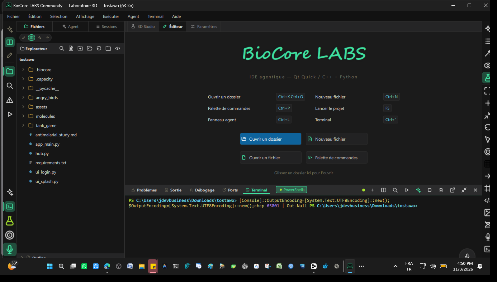
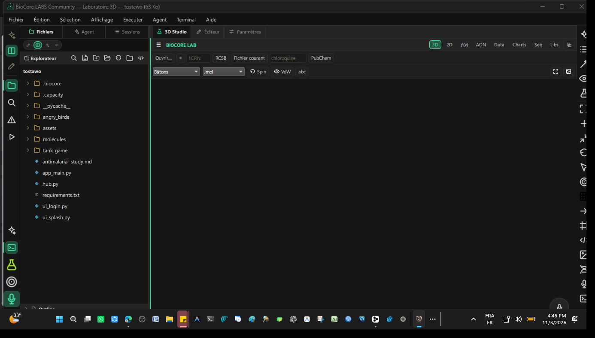
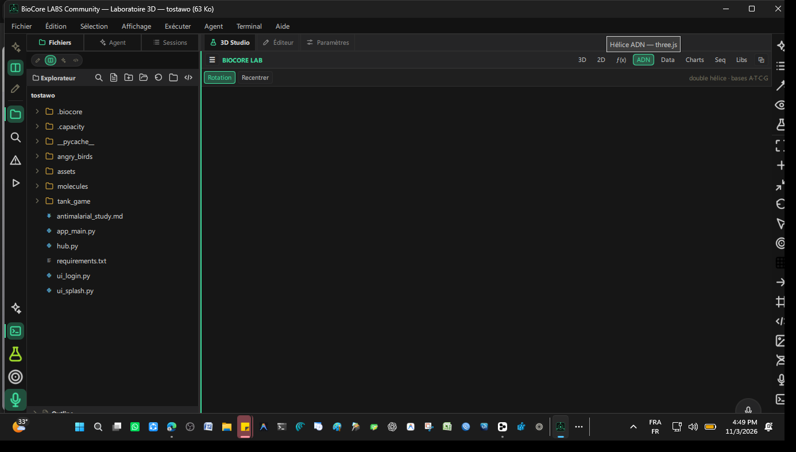

# BioCore LABS 🧬

**Scientific IDE — biology & chemistry workspace.**
C++ / Qt 6 / QML + agentic Python backend · ~13 000 lignes C++.

> Développé intégralement par **Juste Elysée MALANDILA** — Brazzaville, Congo.
> 📫 malandilajusteelysee@gmail.com · linkedin.com/in/justelm · yusticanum.com

---

## 🇫🇷 Présentation

BioCore LABS est un IDE scientifique dérivé de CapacityAI : shell
Qt6 Quick + moteur C++ natif + backend agentique, augmenté d'un
**dock laboratoire** complet et d'un **assistant vocal** docké.

### 🔬 Le dock BioCore LAB

- **Molécules 3D** — rendu 3Dmol.js hors-ligne : PDB, SDF/MOL, MOL2,
  XYZ, mmCIF, PDBQT, CUBE ; styles bâtons/sphères/ruban, surface VdW,
  téléchargement direct RCSB par identifiant, capture PNG
- **Formules** — MathJax v3 embarqué, LaTeX rendu en direct
  (Schrödinger, Michaelis-Menten, SIR, Hardy-Weinberg)
- **ADN 3D** — double hélice three.js animée et interactive
- **Données** — import universel vers registre pandas : Excel, CSV/TSV,
  JSON/JSONL, Parquet, Feather, SPSS `.sav`, Stata `.dta`, SAS,
  MATLAB `.mat`, HDF5, SQLite, **Power BI `.pbix`**, XML, HTML —
  aperçu, statistiques `describe`, export multi-format
- **Stack scientifique** — état des bibliothèques (installé/manquant +
  versions), installation pip en un clic

### 🧠 Agent + voix

- **Outils agent scientifiques** : `lab_status`, `fetch_pdb`,
  `molecule_summary`, `sequence_stats`, `import_data`, `list_frames`
- **Assistant vocal** — orbe animé, transcription de conversation,
  écoute continue, réglages voix/débit/volume/langue
- Hérite de toute la base agentique CapacityAI : boucle d'outils,
  checkpoints, sessions, MCP

### Engineering

| Aspect | Détail |
|---|---|
| Shell | C++17 / Qt 6 Quick — ~13 000 lignes C++ |
| Pont | JSON-RPC/stdio vers backend Python agentique |
| Science | 3Dmol.js, MathJax, three.js, pandas (25+ formats) |

## � Galerie

| Laboratoire 3D — RCSB / PubChem | Hélice ADN (three.js) |
|---|---|
|  |  |

## �📥 Démo

Exécutable Windows en préparation —
[Releases](https://github.com/jdevseer9/BioCore-LABS/releases).
Code source **non public** — disponible sur demande.
